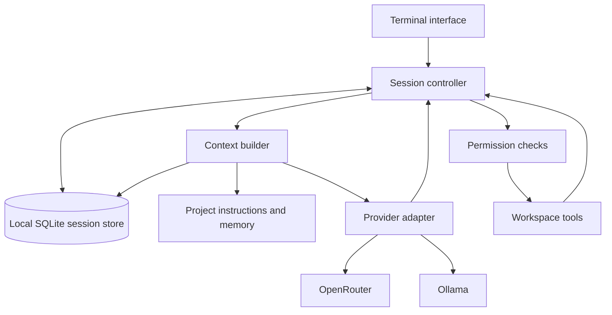

# NightOwl build and release plan

Planning baseline: 10 November 2026. This document describes proposed work, not features already shipped.

Implementation update, 11 November 2026: persistent text sessions, provider setup,
same-session model switching, context budgets, deterministic local compaction,
explicit session task notes, rename/export/import, basic Markdown, and full-width
chat are implemented. The Windows alpha package and GitHub workflows are prepared.
Public publication remains pending. See
[context and memory](context-and-memory.md) for the latest scope and verification.
Model-generated summaries, project/user memory, coding tools, and public
publication remain pending. The baseline findings
and broader acceptance gates below are retained as the original plan.

## 1. Product promise

NightOwl is a local coding-agent harness. It owns the conversation, project context, memory, tools, and permissions. Models are replaceable engines for individual requests.

A user can start with an OpenRouter model, switch to an installed Ollama model when credits run out or by preference, and continue the same saved task. Restarting NightOwl preserves that session. A later coding release also preserves file changes and tool execution history across switches.

Continuity means carrying recorded information and task progress forward. It does not mean transferring a model's internal state, guaranteeing identical answers, or fitting an unlimited transcript into a smaller context window. Full local history and the input sent to a model are separate things.

## 2. Release boundaries

### v0.1.0-alpha: portable conversations

- Local terminal application with OpenRouter API-key access and local Ollama access.
- First-run setup, provider checks, model discovery, and manual model switching inside a conversation.
- Persistent sessions with list, resume, rename, and portable JSON export/import.
- Streaming, stop/retry/continue, preserved partial responses, and restart recovery.
- Context budgeting, durable task notes, and transparent compaction for smaller models.
- Basic Markdown/code rendering, useful errors, and model attribution per response.
- A documented source-install path and tested GitHub release archives for supported platforms.

This release proves the defining feature. It must be described publicly as a chat/continuity alpha until coding tools ship.

### v0.2.0-alpha: usable coding harness

- Workspace-aware file listing, search, reading, diff-based editing, and command execution.
- Read-only Plan mode and Build mode with permission prompts for effects.
- A bounded model/tool loop with portable tool history and interruption recovery.
- Project instructions and explicit persistent memory, with provenance.
- Ability to switch models during a coding task without repeating completed actions.

### v1.0: dependable daily use

- Proven upgrade/migration/recovery behavior, stable configuration and session formats.
- Tested installations on the advertised operating systems and architectures.
- Clear documentation, support procedures, and a sustained period of successful alpha use.
- Measured context and tool reliability, not a feature-count deadline.

Defer subscription/OAuth integrations, automatic cross-provider fallback, accounts, billing, cloud sync, plugin/MCP ecosystem, subagents, embeddings, multimodal context, and elaborate theme management. A ChatGPT subscription is not part of the initial OpenRouter/Ollama integration.

## 3. Starting point

The working tree already contains the React/OpenTUI interface, streamed chat, stop/reset, OpenRouter/Ollama configuration, and 19 passing tests. TypeScript checking also passed during the initial review. These tests use mock models; live provider connectivity has not been established.

The next gaps are concrete:

- Messages exist only in React state; quitting loses them.
- The model/config is selected at startup.
- The message representation is text-only and has no durable request/tool lifecycle.
- Most slash commands are notification placeholders.
- There is no independent harness package, database, context budget, or tool runner.
- The CLI package is private and has no published command/bin or distribution build.
- No LICENSE or GitHub Actions workflows were found in the inspected project files.
- The manifests say 1.0.0, but the product is at an early stage; align all release metadata with the alpha sequence before publishing.

Origin is configured as https://github.com/Diwansu-pilania/nightowl. An unauthenticated GitHub API lookup returned 404. It could be private, unavailable, or renamed; confirm the intended repository and visibility before publishing. Existing uncommitted work must be reviewed and preserved when preparing the baseline commit.

## 4. Architecture

Keep Bun, TypeScript, React, OpenTUI, and the existing AI SDK. Introduce a UI-independent core rather than rewriting the terminal interface.



Suggested structure, introduced incrementally:

```text
packages/
  core/src/
    config/          validated settings, precedence, credential references
    sessions/        controller, canonical types, request lifecycle
    storage/         SQLite repository, schema migrations, import/export
    providers/       OpenRouter and Ollama adapters, model capabilities
    context/         request assembly, token budgets, compaction
    memory/          explicit notes, instruction loading, provenance
    agent/           bounded tool loop and modes (v0.2)
    tools/           file/search/edit/process operations (v0.2)
    permissions/     workspace grants and action approvals (v0.2)
  cli/src/
    components/      TUI rendering and input
    providers/       React facades subscribing to core state
    commands/        slash commands and command-line commands
scripts/             build, package, and distribution smoke checks
docs/                setup, architecture, providers, security, releases
.github/workflows/   CI and tag-driven releases
```

The core must not import React or OpenTUI. `ChatProvider` becomes a subscription/facade over the session controller. Persist canonical data, not SDK message objects; adapters convert into the current AI SDK/provider request format.

## 5. Session storage and canonical data

Use Bun's SQLite support behind a small repository interface. SQLite gives transactional writes, migrations, and indexed session lookup without a separate database service. Export/import uses a versioned JSON interchange format rather than raw database copies.

Start with these logical records:

- **Session:** ID, title, canonical workspace path, created/updated timestamps, selected provider/model, schema version, task status.
- **Message:** ID, session/turn/attempt IDs, role, ordered content parts, status, timestamps, and model attribution for assistant content.
- **Content parts:** text initially; typed tool call/result and file references added in v0.2. Unknown future parts must not silently execute or disappear on import.
- **Attempt:** request ID, provider/model, started/completed/interrupted/failed status, normalized error, finish reason, and reported usage.
- **Event:** ordered state transitions such as model selected, request started, interruption, and compaction created. Avoid a token-by-token event log.
- **Summary/memory:** source message range or IDs, original facts/notes, scope, timestamps, and provenance.
- **Tool execution (v0.2):** stable call ID, arguments, approval, started/completed state, output references, and execution outcome.

Rules that must hold:

1. Commit user input before starting the network request.
2. Checkpoint streaming text at a bounded interval, initially around 100–250 ms, and flush on finish, stop, switch, and clean exit. A hard crash may lose the last unflushed fragment; document and test that bound.
3. Use transactions for related state changes, foreign keys, and versioned migrations. Back up safely through a SQLite-aware mechanism before upgrading; do not copy only the main file while WAL is active.
4. On restart, turn orphaned running requests into interrupted attempts. Never silently replay tools or submit a paid request.
5. Keep failed/interrupted attempts in the audit history. Build the model-visible conversation from the selected completed turns and explicitly represented partial work.
6. Scope updates by session/request ID so stale streaming callbacks cannot append into a new session or overwrite a newer request.
7. Allow only one active writer/controller per session. Another terminal may inspect it or receive a clear busy message.
8. Imported sessions are inert data: validate schema/size and remap workspace paths; never import credentials, trust grants, or auto-run actions.

Store application state outside the project and repository. Use standard OS configuration/data locations through one path helper; for example, Windows roaming application data for config and local application data for the database. Provide environment/config overrides for portable installations and tests.

## 6. Provider contract and configuration

Each adapter should support configuration validation, health checks, model listing/details, model creation, capability metadata, and error normalization. Streaming can reuse the existing AI SDK integration. Adapter-specific behavior belongs here, not in terminal components.

### OpenRouter

- Send the API key only to the configured, trusted OpenRouter origin.
- Discover model IDs through the catalog, with cached metadata and a manual-ID option.
- Track context/output limits, supported parameters/tools, and reported pricing when available; metadata can be incomplete or stale.
- Treat authentication, insufficient-credit, rate-limit, context-limit, transient, and in-stream failures separately. Use structured provider error metadata where available, not message matching alone.
- Bounded retries may honor Retry-After for a suitable transient failure. Do not automatically restart a partly delivered response or move a user's private context to another provider.
- Keep costs labeled as estimates unless supplied by a reliable provider usage record. Catalog presence does not guarantee account access or availability.

### Ollama

- Default to the local server; preserve a configurable origin for users who intentionally run another host.
- Use `/api/tags` to discover installed models and `/api/show` for details/capabilities.
- Separate the server origin from its `/v1` compatibility path when building discovery and chat URLs.
- Initially reuse OpenAI-compatible streaming where it passes contract tests. If effective context settings or tool semantics require the native chat API, adapt inside the provider layer.
- Distinguish advertised model context from the effective running/configured context. Allow an explicit conservative override and do not assume the maximum fits the laptop's RAM/VRAM.
- Never send an OpenRouter key to Ollama. Do not download models automatically; show an explicit install/pull action and explain that model downloads require connectivity.
- Local-only operation must not call cloud catalogs, cloud summarizers, analytics, or update services in the background.

### Configuration and secrets

- Proposed precedence: explicit CLI option > environment > user config > defaults. Do not accept provider endpoints, keys, or expanded permissions from an untrusted repository configuration.
- Keep normal preferences in validated config. API keys come from environment or a masked setup prompt with explicit credential storage.
- Prefer the OS credential store when practical. If alpha uses a dedicated credentials file, restrict local access, disclose that it is stored locally, and exclude it from logs/exports. Plain JSON is not encryption.
- The distributed launcher must control dotenv loading; do not accidentally pick up arbitrary project `.env` files. Preserve the documented development `.env` workflow separately.
- Remove unavailable login/upgrade commands from the initial public interface. Avoid a fixed model ID as a promise of availability; setup should select a discovered model or accept a supplied ID.

## 7. Switching models safely

Manual switching is the first feature. The selected provider/model is session state, and every response records the model that actually generated it.

1. The user opens `/models` and selects an available destination.
2. Validate credentials/connectivity, destination capabilities, and context settings.
3. If text is streaming, offer to stop and switch or wait until the turn finishes. Flush and mark any partial answer as interrupted. This creates a new request; it does not splice two live provider streams.
4. In v0.2, wait for a safe tool boundary. A process still stopping remains visible; an uncertain side effect needs reconciliation before continuing.
5. Record the model-switch event and destination selection without changing the session ID.
6. Rebuild context for the destination model, preserving decisions, latest user intent, and completed tool evidence.
7. Show the new model in the status bar. Continue/retry after an interrupted turn is a deliberate action; ordinary switches apply to the next message.

On quota/credit exhaustion, retain the session and present Retry / Switch model / Stop as appropriate. Retry starts a linked attempt, and failed text must not appear as a completed assistant answer in the next request. Starting with Ollama and switching to OpenRouter should make clear that selected local context will now be sent to the cloud provider.

A model without tool support can still handle chat/read-only explanation. Switching into Build mode requires a verified compatible model. Never interpret plain model text as permission to execute a command.

## 8. Context and memory strategy

### Context builder

Build requests from a stable policy, the current project/task notes, the relevant summary, recent turns, selected file/tool evidence, and the latest user input. Keep trust levels and provenance separate; repository content is data/instructions with a defined scope, not system authority.

Calculate usable input capacity from the effective context limit minus requested output tokens, tool schemas, and a conservative safety margin. Count all message overhead, file contents, and tool output. Use an appropriate tokenizer where available and clearly marked conservative estimates otherwise; a characters-to-tokens heuristic is not an exact token count.

When context would exceed the budget:

1. Remove redundant attachments and repeated tool output from the request, retaining the originals locally.
2. Keep the latest user instruction, current task state, and recent coherent turns.
3. Summarize older completed turn groups into a versioned summary that retains decisions, constraints, relevant files, unresolved questions, and completed actions.
4. Persist source ranges and rebuild against the destination budget after a switch.
5. If the minimum useful context still does not fit, explain the limit and let the user choose a larger model or reduce selected context. Do not silently drop the current task.

Do not split a tool call from its result. Completed portable tool pairs may be translated by an adapter; a model unable to accept tool messages gets clearly labeled factual execution summaries with source references. Provider-specific reasoning blocks, signatures, or opaque state are not portable context.

Compaction is lossy. Keep full originals and make `/context` show what is included, summarized, and excluded. Test retained facts; do not promise perfect recall. Begin with explicit task notes and deterministic trimming. Add model-generated summaries once the persistence/switch path works. Local mode must summarize locally or use a deterministic fallback; cloud compaction is an explicit request with normal usage accounting.

### Memory scopes

- **Session:** goal, progress, decisions, unresolved items, selected context.
- **Project:** user-maintained instructions and explicit durable project notes.
- **User:** optional preferences explicitly saved by the user.

Support inspect/edit/remove for durable notes. Associate notes with their source; do not silently promote model speculation or tool output into permanent facts. Start with structured text/JSON/SQLite notes. A vector database and automatic repository embeddings are unnecessary for the first releases.

## 9. Coding tools and permissions for v0.2

Implement in this order: list files, search, read file, apply patch, run command. Use native argument arrays and filesystem APIs rather than interpolating paths into shell strings. Search should respect ignore rules and have a bounded fallback when `rg` is absent.

The controller runs a bounded cycle: prepare context → request model → validate tool calls → request any required approval → execute → persist results → continue or finish. Set limits on iterations, output size, request time, and process duration; never let a runaway loop continue indefinitely.

- Canonicalize workspace paths and check symlink/junction escapes before reads and writes. Exclude credentials and sensitive local state by default; outside-workspace access needs a specific grant.
- File edits show a diff and require the selected policy's approval. Verify the file still matches the read/base hash; report conflicts instead of overwriting user edits. Use atomic replacement where supported.
- Commands show their exact command, shell, working directory, and intended scope. Choose the correct shell per OS, filter provider credentials from the child environment, cap output, and support cancellation of the process tree.
- Arbitrary commands are powerful even inside a workspace. Permission prompts are not OS sandboxing; describe that limitation accurately. Strong OS isolation is a later engineering feature.
- Persist the call/approval record before effects and the result afterward. After a crash between these steps, label the effect unknown and inspect/ask before re-running; do not claim exactly-once execution for external commands.
- Tool/network errors and cancellations preserve session progress. A provider switch must never rerun an already completed file edit or command just to reconstruct history.
- Treat terminal output as untrusted display data: strip unsafe control sequences, prevent rendering from executing actions, and keep output/attachment size limits.

Plan mode exposes read-only tools. Build mode enables guarded edits and commands. Git commits, pushes, PR creation, and destructive operations should be explicit user-directed actions rather than initial autonomous defaults.

## 10. Proposed user experience

Future commands below describe the target interface; they do not work in the current build yet.

- `nightowl`: launch in the current project; first launch opens provider setup.
- `nightowl --resume`: offer recent sessions for the current workspace.
- `nightowl doctor`: report config, data directory, terminal/runtime, provider reachability, and selected model problems without exposing secrets. Expensive inference checks are opt-in.
- `nightowl --version` and `nightowl --help`: run without starting the TUI or requiring credentials.
- `/models`: provider/model picker with search and capability details.
- `/sessions`, `/new`, `/rename`, `/export`, `/import`: session lifecycle; import never restores executable trust.
- `/context`, `/compact`, `/memory`: inspect and manage retained information.
- `/usage`: actual reported tokens and clearly labeled estimates; unavailable values remain unavailable.
- `/agents`: Plan/Build selection once those behaviors exist.

Keep model/provider attribution next to replies, and expose streaming/saving/compacting/recovery status. Use bounded history rendering for long sessions. Keep setup errors actionable and avoid showing a selectable command that only simulates success.

## 11. Implementation sequence and acceptance gates

### Milestone 0 — Review baseline and test packaging risk

- Review the current tracked/untracked edits and preserve a coherent Phase 1 baseline.
- Confirm the repository location, intended public visibility, package/command naming, and license choice.
- Pin the Bun version used in CI and record the supported minimum.
- Do an early executable/asset packaging experiment on the current UI before expanding it. OpenTUI uses native platform libraries; compiled JavaScript alone may be insufficient.

**Done when:** existing tests/typecheck pass and an unpacked artifact launches outside the checkout on at least the development OS, or a specific documented source-install fallback is chosen.

### Milestone 1 — Core and persistence

- Extract session/controller and AI logic into `packages/core` without changing existing chat behavior.
- Add canonical types, transactional SQLite storage, migrations, stream checkpoints, and restart recovery.
- Implement session list/resume/rename plus export/import validation.

**Done when:** a conversation survives a clean restart; interrupted requests recover honestly; malformed/imported data cannot execute anything; the existing UI still works through the core facade.

### Milestone 2 — Setup and provider adapters

- Add validated user configuration, credentials handling, model discovery/cache, and health checks.
- Implement the same adapter contract for OpenRouter and Ollama, including distinct origin/compatibility paths.
- Add mocked HTTP contract tests in addition to SDK mock tests.

**Done when:** a clean machine can configure either provider, select a model, and get a reply; keys are absent from logs/exports and never cross provider origins.

### Milestone 3 — Same-session switching

- Implement the `/models` picker and transactional selection/switch behavior.
- Add linked attempts, stop/retry/continue semantics, stale-callback protection, and quota/error recovery.
- Attribute responses and usage to the generating model.

**Done when:** OpenRouter → Ollama → OpenRouter all use one session ID, preserve earlier facts, survive a restart, and retain failed/partial attempts without corrupting future prompts.

### Milestone 4 — Context and explicit memory

- Implement model-specific budgets, coherent history selection, `/context`, and durable task notes.
- Add compaction with source references and local-only behavior.
- Add a smaller-context handoff evaluation and test oversized files/tool evidence before tools ship.

**Done when:** switching into a smaller window produces a valid request that preserves a fixed set of important facts; original history remains inspectable; no covert cloud call occurs in local mode.

### Milestone 5 — Publish the continuity alpha

- Complete basic Markdown/code rendering and actionable onboarding; remove product placeholders.
- Finish platform builds, release archives/checksums, installation docs, privacy notes, license, and contributing/security guidance.
- Verify source installation and each advertised binary in a clean environment; publish only passing targets.
- Tag and release v0.1.0-alpha.1, collect reproducible issues, and fix continuity/install blockers.

**Done when:** a new user can install without this checkout, configure OpenRouter or Ollama, switch models, and resume after restart using only the README.

### Milestone 6 — Coding harness

- Add workspace discovery, instructions, read-only tools, then guarded edits and commands.
- Add Plan/Build modes, the bounded agent loop, tool-event persistence, and recovery.
- Exercise provider switching after completed tools and while an effect is unresolved.

**Done when:** NightOwl can inspect a small project, propose a change, apply an approved patch, run an approved check, and hand off to another model without repeating effects.

### Milestone 7 — Publish and harden v0.2

- Repeat installation and provider tests against packaged artifacts.
- Add real-project demonstrations, permission/recovery documentation, and release migration notes.
- Gather alpha feedback before committing to stable v1.0 compatibility.

**Done when:** core coding workflows and failure recovery pass on all advertised platforms, including upgrades from the continuity alpha.

Indicative planning allowance for one focused developer: roughly 3–5 weeks for milestones 0–5, then 2–4 additional weeks for the first coding alpha. These are estimates, not a delivery commitment; native packaging, model behavior, and cross-platform process control are the largest uncertainties. Re-estimate after milestone 0 and the first real two-provider handoff.

## 12. Verification strategy

Keep normal CI independent of paid APIs. Expand the current tests with:

- Storage: migrations, transactions, stream checkpoints, crash recovery, session locking, export/import, and stale callbacks.
- Adapter contract tests against a local mock HTTP server: SSE chunks/errors, tool messages, authentication isolation, cancellation, timeouts, 401/402/429/5xx, and capability normalization.
- Context tests: destination budgets, coherent turns/tool pairs, protected current instruction, compaction references, unsupported parts, and local-only behavior.
- UI tests: switch while idle/streaming, error actions, resume, model attribution, prompts, and focus/keyboard behavior.
- Tool integration tests on disposable fixtures: path traversal/symlinks/junctions, patch conflicts, secret filtering, command quoting, process cancellation, output limits, and crash between effect/result persistence.
- Distribution tests: `--help`, `--version`, clean first run, writable data paths, native assets, runtime independence, no embedded keys, and an end-to-end mocked chat from an unpacked artifact.

The existing 19 tests are a baseline, not a release gate by themselves. Use a small explicit live test before each release with a configured OpenRouter model and an installed Ollama model. Record model IDs, runtime/context settings, and results; keep credentials and sensitive prompts out of CI output. Live tests are opt-in on trusted runs, not pull requests from forks.

The main acceptance scenario:

1. Start a session with OpenRouter and establish several project requirements, decisions, and a pending task.
2. Trigger a simulated credit/rate-limit error and choose an installed Ollama model.
3. Ask about the earlier requirements; inspect both assembled context and the model's response.
4. Continue the task, stop a partial answer, quit, and reopen the session.
5. Switch back to OpenRouter and verify the same recorded task state.
6. Repeat with a much smaller effective context budget and compaction.
7. In v0.2, insert a real approved edit and command before switching; verify neither executes again on handoff/restart.

Model output is nondeterministic. Use deterministic payload assertions for correctness and a small scored factual checklist for live continuity; a plausible answer alone does not prove the right history was sent.

## 13. Local installation and platform support

First provide a source path: install the documented Bun version, clone the public repository, run `bun install --frozen-lockfile`, configure a provider, and run the documented CLI script. Keep contributor development commands separate from the installed end-user command.

Preferred end-user distribution is a GitHub Release archive containing `nightowl`/`nightowl.exe` plus any necessary OpenTUI native assets and licenses. Compile with the selected Bun toolchain only after proving required native libraries, workers, and parser assets are bundled or resolved relative to the executable. An archive with companion assets is acceptable; do not promise a single file before testing it.

Initial target matrix:

- Windows x64, tested in Windows Terminal/PowerShell.
- macOS arm64, then x64 when a runnable test environment is available.
- Linux x64 on a stated glibc baseline.

Treat Linux arm64, Windows arm64, musl/Alpine, and other terminals as additional targets with their own verification. Cross-compilation success is not runtime verification. WSL runs the Linux build. Only list a platform as supported after its install and core behavior pass.

Users install Ollama and download a suitable model separately. Local model speed/quality depend on hardware and model size; publish a small tested model/hardware guide without promising every model will fit every laptop. OpenRouter needs network access and the user's own usable API key. No NightOwl account or hosted backend is required.

Choose the native GitHub archive as the initial binary distribution and source install as the fallback. Later add an npm/Bun launcher only after confirming package-name availability and testing its runtime/download behavior. Do not advertise `npm install -g nightowl`, Homebrew, winget, or shell installers until they actually exist and pass install tests.

## 14. GitHub release workflow

### Repository preparation

- Confirm origin and make the intended repository public when it is ready to release.
- Choose a license before distribution. MIT is the recommended default for easy reuse; the owner must select the actual license and copyright attribution.
- Review dependency licenses and preserve notices for redistributed native assets.
- Add README quick start, demo, screenshots, platform matrix, provider setup, troubleshooting, architecture, privacy/storage behavior, CONTRIBUTING, SECURITY, and bug-report templates.
- Review the worktree and Git history for secrets before a public release. Do not rewrite history blindly; if a secret was committed, revoke it and plan targeted cleanup.
- Replace placeholders and align package versions/changelog with the release tag.

### CI

- For pushes/PRs: frozen dependency install, typecheck, core/UI tests, and required fixture tests on the supported OS matrix.
- For release candidates: platform packaging, dependency/native-asset checks, and clean unpacked-artifact smoke tests.
- Keep workflow permissions minimal and dependencies/actions pinned. Never expose release/API credentials to untrusted pull-request execution.
- No default network model usage in ordinary CI.

### Publishing

1. Review and commit the intended changes; keep unrelated edits out of release commits.
2. Verify install/upgrade instructions from the candidate artifact and complete the live two-provider acceptance test.
3. Create an annotated version tag after required checks pass.
4. Tag workflow builds or retrieves verified platform artifacts and produces SHA-256 checksums, source/license notices, and release notes.
5. Publish the GitHub prerelease with supported-platform claims matching the tested matrix. A checksum verifies integrity, not publisher identity; use platform signing/notarization if available and disclose unsigned status accurately.
6. Verify public access and downloads as a fresh user. Later distribute through package managers separately.

Keep previous release assets available. Back up/migrate user state with supported version checks; refuse incompatible downgrades instead of corrupting a newer database. An application update must preserve sessions and credentials.

## 15. First implementation slice

Begin with milestone 0 followed by a narrow persistence slice: canonical text-message/attempt types, a SQLite session repository, a core session controller, and resume after restart. Keep the current UI and provider calls working through that slice. Then add provider selection and same-session switching.

This order makes the product's central promise testable early and avoids implementing the picker over temporary React-only state that must later be replaced.

## 16. Sources and inspection notes

- Current working tree: README, Phase 1 guide, CLI source/config/tests, package manifests, Git status/remotes.
- Installed OpenTUI 0.5.11 README/package metadata: native Zig/FFI libraries and platform-specific distributions; Bun minimum varies for Windows arm64. Recheck support when pinning the release toolchain.
- [Ollama model listing](https://docs.ollama.com/api/tags).
- [Ollama model details and capabilities](https://docs.ollama.com/api-reference/show-model-details).
- [OpenRouter error and streaming-failure behavior](https://openrouter.ai/docs/api_reference/errors-and-debugging).

The proposed build strategy still needs the milestone 0 packaging experiment. The document does not claim native artifacts, public repository access, provider credentials, or release workflows have already been verified or published.
