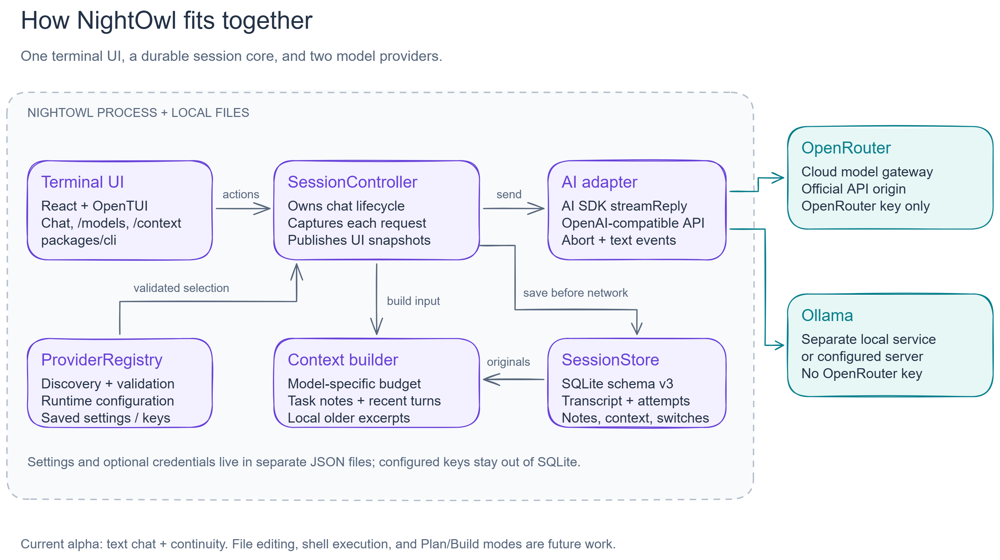
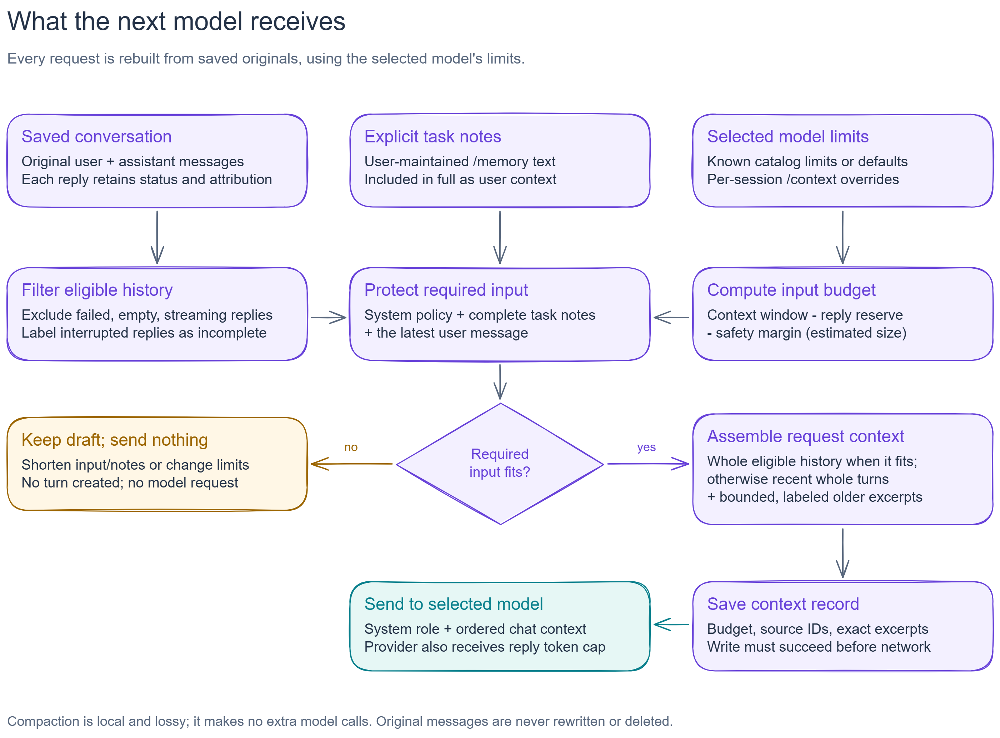
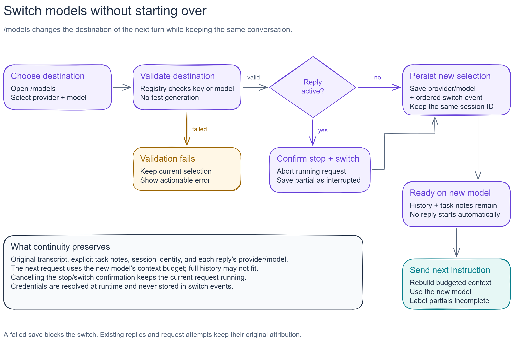
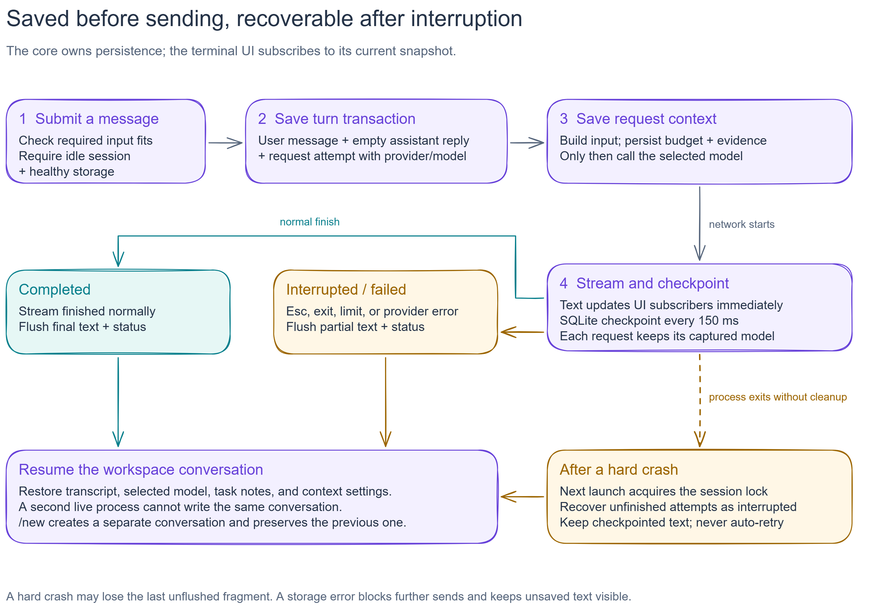

# NightOwl visual guide

These diagrams describe the implemented text-chat and continuity flow. Editable
`.excalidraw` files live beside PNG images exported from
[Excalidraw](https://excalidraw.com). The main README and implementation guides
use the same images.

## Architecture

NightOwl's terminal UI observes a core-owned session. Provider discovery and
validation are separate from streamed chat; SQLite holds conversation data,
while preferences and optional credentials use separate JSON files. Ollama is
a separate service, even when it runs on the same machine.

[Edit the drawing](architecture.excalidraw). Implementation:
[terminal entry point](../../packages/cli/src/index.tsx),
[React subscription](../../packages/cli/src/providers/chat/index.tsx),
[session controller](../../packages/core/src/sessions/controller.ts),
[provider registry](../../packages/core/src/providers/registry.ts), and
[AI adapter](../../packages/core/src/ai/model.ts).

## Context assembly

Context is rebuilt from original messages for each request. Required input
must fit before a turn is created. Older excerpts are local, bounded, and
lossy; task notes carry essential instructions in full. The context record
must be saved before a provider request starts.

[Edit the drawing](context-assembly.excalidraw). Read
[context and task memory](../context-and-memory.md); implementation:
[context builder](../../packages/core/src/context/builder.ts) and
[session controller](../../packages/core/src/sessions/controller.ts).

## Model switching

Validate the destination, confirm stopping an active reply, and persist the
provider/model selection and switch event. The next message uses the new model;
switching alone never starts another generation. Previous replies retain their
original attribution, and interrupted text is labeled incomplete in context.

[Edit the drawing](model-switching.excalidraw). Read
[provider switching](../provider-switching.md); implementation:
[model picker](../../packages/cli/src/components/model-picker.tsx),
[provider registry](../../packages/core/src/providers/registry.ts), and
[session controller](../../packages/core/src/sessions/controller.ts).

## Session lifecycle and recovery

Persist the turn and context before network activity, update UI subscribers on
each text chunk, and checkpoint to SQLite every 150 ms. Normal completion,
stopping, and provider failures flush text and status. Crash recovery retains
checkpointed text and marks unfinished attempts interrupted without retrying.

[Edit the drawing](session-lifecycle.excalidraw). Read
[persistent sessions](../persistent-sessions.md); implementation:
[session controller](../../packages/core/src/sessions/controller.ts) and
[SQLite session store](../../packages/core/src/storage/session-store.ts).

## Edit and export

1. Open [Excalidraw](https://excalidraw.com), choose **Open**, and select the
   corresponding `.excalidraw` file from this folder.
2. Edit the drawing. Boxes and their text are grouped; adjust connected arrows
   when moving a box. Keep branch labels and the scope notes readable.
3. Save the editable scene back to its existing `.excalidraw` filename.
4. Choose **Export image** (`Ctrl+Shift+E`), turn **Background** on and
   **Dark mode** off, select **2×**, and export a PNG with the matching filename.
5. Check text, arrows, and margins at normal reading size, then commit the scene
   and PNG together. Existing Markdown references need no changes.

Purple identifies NightOwl components and normal steps; teal identifies model
services or ready/completed outcomes; amber identifies refusal, interruption,
or recovery. Neutral text explains boundaries and limitations. Colors accompany
explicit labels so the flow is understandable without relying on color alone.

Keep diagrams aligned with the code. File editing, command execution,
model-generated summaries, and Plan/Build modes are future work and should not
appear as implemented components.
