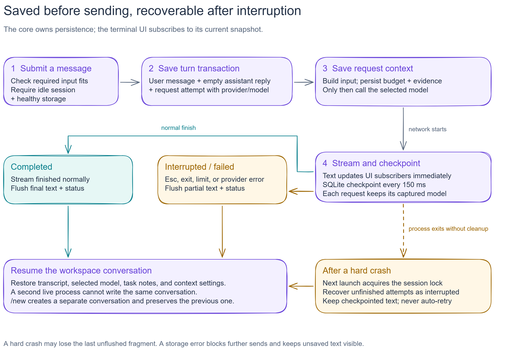

# Persistent sessions: first implementation slice

Implemented on 10 November 2026. This builds on Phase 1 and changes ownership of
chat state: `packages/core` now owns the session and `packages/cli` renders it.
Updated for [provider switching](provider-switching.md) and [context management](context-and-memory.md).

[Editable Excalidraw source](diagrams/session-lifecycle.excalidraw) ·
[Diagram guide](diagrams/README.md).

## Data and lifecycle

- `SessionStore` creates schema version 3 in SQLite. Sessions are workspace
  scoped; messages and request attempts have stable IDs and explicit lifecycle
  states. Text messages, model-switch events, task notes, context limits, and
  context records are supported. Tool parts, model-generated summaries, and
  imports/exports come in later milestones.
- `SessionController` saves user input, an empty assistant reply, and a request
  attempt in one transaction before calling the model. A failed transaction
  never starts the network request.
- Streaming text updates subscribers immediately and is checkpointed to disk
  every 150 ms. Stop, reset, resume, and dispose flush synchronously. Delayed
  callbacks only update their original active request.
- A stopped or recovered assistant reply has `interrupted` status. When reused
  as context, its text is explicitly labeled incomplete. Failed/empty answers
  are excluded from model input; originals remain in the database.
- `/new` creates a new session, preserving the old one. `/sessions` can resume
  it. Launching normally reopens the last opened session in the canonicalized
  working directory; `--new`, `--sessions`, and `--resume <id>` control this.
- On shutdown, the entry point disposes the controller before the process
  exits. React subscribes through `useSyncExternalStore` and owns no persistence.

## Concurrency and recovery

Session ownership is recorded transactionally with a unique owner ID and local
process ID. A second live owner cannot write or recover it. Once a process has
exited, acquisition turns its unfinished attempts into interrupted attempts,
preserving the checkpointed text. Recovery never retries a provider request.

This locking design is for one machine and a local filesystem. Do not share the
database between hosts or put it on a network filesystem. PID reuse can make a
stale lock appear live; the conservative behavior is to refuse acquisition
rather than risk concurrent writes. An explicit lock-recovery workflow can be
added later. No automatic destructive database repair is attempted.

Schema versions newer than the implementation are rejected without migration.
The v1/v2-to-v3 upgrade serializes a consistent SQLite snapshot before altering
the schema, including committed WAL pages. It refuses migration while an older
live process owns a session. Selected models are backfilled from existing
attempts, and previous messages remain intact.

## Storage and privacy

The default data path follows the host OS. `NIGHTOWL_DATA_DIR` supports isolated
tests or a custom local directory. Session records store the provider/model ID,
not provider credentials. Known API keys are redacted from provider error text.
This does not sanitize arbitrary user/model messages or encrypt the database.

A storage failure blocks sends and new sessions so the user can copy unsaved
text. A hard crash may lose text since the last checkpoint. The exact last
screenful cannot be guaranteed during a sudden power loss or disk failure.

## Verification and packaging

Tests cover real SQLite reopen, transactions, a process exiting without cleanup,
writer exclusion, stale response callbacks, immediate stop/new requests, write
failures, replayed context, and the terminal session picker. Model traffic is
mocked; no paid provider is needed for the suite.

`bun run build:cli` compiles the current platform executable and disables runtime
autoload of workspace dotenv/bunfig files. Initial testing uses Windows x64 and
Bun 1.4.2; macOS and Linux distribution remain to be verified. Basic native TUI
startup alone does not establish complete release readiness.

The Windows executable was also copied into a directory outside the repository,
launched against a local mock HTTP provider, sent a message, exited through
`/exit`, and reopened. The second request contained the first turn's context.
An unrelated `.env` and invalid `bunfig.toml` in that directory were ignored.
This verifies packaging and request plumbing on this machine; it is not a live
OpenRouter/Ollama model test or proof of clean-machine support on other systems.

## Next slice

Provider setup, mutable model selection, context budgets, local excerpt compaction,
and explicit task notes are implemented. Original history remains unchanged.
