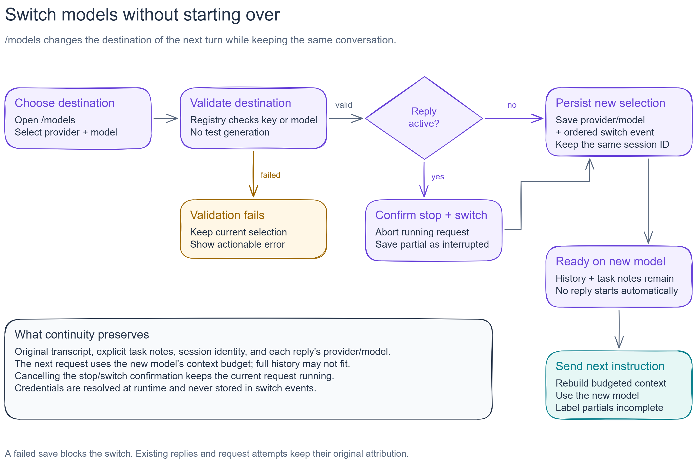

# Provider setup and same-session model switching

Implemented on 10 November 2026. NightOwl supports OpenRouter API keys and an
Ollama server, with manual provider/model switching while keeping the same
persisted conversation.

[Editable Excalidraw source](diagrams/model-switching.excalidraw) ·
[Diagram guide](diagrams/README.md).

## User flow

Run `bun run start --setup`, or enter `/models` in a chat. Choose a provider,
configure a missing key/server, and select a discovered model or enter its ID.
Environment-free first launches open setup automatically. An unknown provider
name or missing OpenRouter key also opens setup so it can be corrected.
Malformed model IDs, server URLs, or saved settings produce a startup error;
correct those values before relaunching.

OpenRouter key input never renders the raw key or sends it through the chat
textarea. Enter uses it in memory for this run. Ctrl+S validates and saves it
locally in a dedicated unencrypted credentials file. Ctrl+E in the model list
lets the user replace a key or change the Ollama URL. Choose a model after
updating connection settings to apply them to the session.

The selected destination is checked before switching. During a streamed reply,
the picker asks whether to stop and switch. Cancellation leaves the running
request alone. Successful switching synchronously saves the partial reply,
records the selection, and changes the next request's model. No replacement
request is generated automatically. Each answer retains its model attribution.

## Core components

- `ProviderRegistry`: per-provider configuration resolution, model discovery,
  connection checks, request cancellation/timeouts, and a five-minute in-memory
  catalog cache. Only the selected provider's catalog is requested.
- `ProviderSettingsStore`: validated user preferences and optional credentials
  in the NightOwl data directory. Updates use temporary-file replacement.
- `SessionController`: creates a new model instance for a selected configuration
  and captures that model/config on each request. Late stream callbacks cannot
  change a new request or attribute an old error to the new provider.
- `SessionStore`: persists selected provider/model and an ordered switch history
  with a transaction. Request attempts and old messages are not rewritten.
- `ModelPicker` and `SecretInput`: provider selection, model search, manual IDs,
  connection editing, masked key entry, and explicit active-response handling.

The UI validates through the registry; the controller performs the synchronous
state transition. Validation cancellation, auth failures, and stale session IDs
prevent the switch. A settings-file write failure after a successful switch is
reported separately: that session's choice is still saved in SQLite.

## Provider differences

OpenRouter uses its public `/api/v1/models` catalog and `/api/v1/key` for key
validation. Catalog entries expose advertised context capacity and tool
support when present. Image-only entries are excluded from this text UI.
Manual model IDs can be supplied even when the catalog is unavailable; actual
account/model availability and credits are determined when a reply is requested.

Ollama uses `/api/tags` and `/api/show` for installed-model discovery/validation,
and `/v1/chat/completions` through the existing AI SDK for chat. URL normalization
accepts a server origin or `/v1` URL, including a reverse-proxy path prefix.
Advertised model limits are not treated as the effective running context size.
Model downloads and server startup remain user actions.

OpenRouter credentials only go to its fixed official API origin, and redirects
are disabled for discovery, validation, and chat. Ollama adapters strip the
cloud key even if a caller supplies one accidentally. Local-only operation does
not contact OpenRouter in the background. Selecting OpenRouter makes clear that
the next turn sends saved context to that provider.

HTTP credit/rate-limit errors give actionable switching advice. Automatic SDK
retries are disabled for chat; an error does not silently create another paid
attempt or continue with another provider. This milestone does not add a
dedicated retry command: send a follow-up instruction after switching.

## Persistence and precedence

Schema v2 adds selected-provider/model fields and a `model_switches` table. The
v1 migration first writes a consistent `sessions.sqlite.v1-<timestamp>-<id>.sqlite`
snapshot, then upgrades transactionally and backfills choices from prior
attempts. It refuses upgrades while a live v1 process owns any session.
Backups contain conversation data and are not automatically deleted.

Explicit environment model/provider selections override the restored session
at launch. Otherwise the session choice wins, followed by saved defaults and
the legacy defaults. Environment keys/server URLs override saved settings on
launch; explicit in-app changes take precedence for that run. Keys are resolved
again on restart and are never persisted in session/switch records.

The optional credentials file is not encrypted and does not use an OS keychain.
It uses restrictive file modes on POSIX systems and the user's data directory
permissions on Windows. Chat contents and user-entered model/URL values should
not be used to store secrets. API errors redact the configured key; arbitrary
conversation text is not sanitized.

## Verification and remaining work

Tests cover model discovery, secret isolation, masked key entry, cancellation,
auth/rate-limit errors, the terminal picker, stopping before switching, restored
selections, transactional switch events, and migration backups with WAL data.
A local HTTP fixture exercises the real compatible model adapter in both
provider modes and checks replayed history and authorization headers.

Verification passed with 53 tests, workspace type checks, and a Windows x64
build using Bun 1.4.2. The compiled executable was also tested outside the
repository root with an isolated data directory and a local Ollama HTTP fixture:
setup discovered models, `/models` switched from one model to another, the next
request replayed prior messages, and a restart restored both selection and
history. Ollama requests carried no authorization header.

OpenRouter's public model catalog can be checked without generation or a key.
Paid OpenRouter inference and inference against a real installed Ollama model
still require a separate live test with the user's configured models.

Context budgeting, local excerpt compaction, and task notes are now implemented
in [the context milestone](context-and-memory.md), with schema v3. The implementation
does not promise unlimited context or equal behavior across models.
Coding tools, Plan/Build permissions, export/import,
OAuth/subscription access, and public cross-platform releases remain later work.
